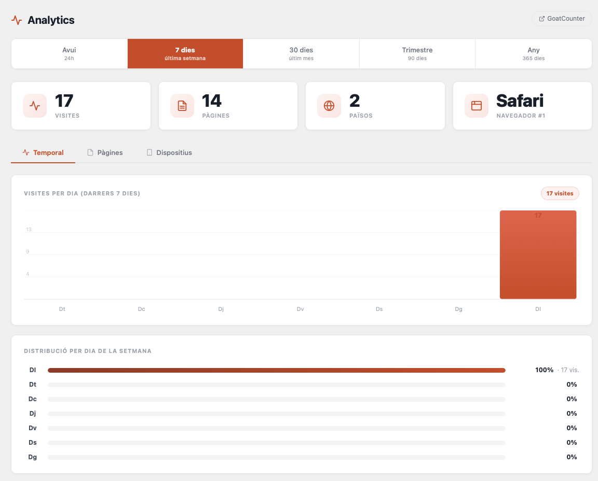
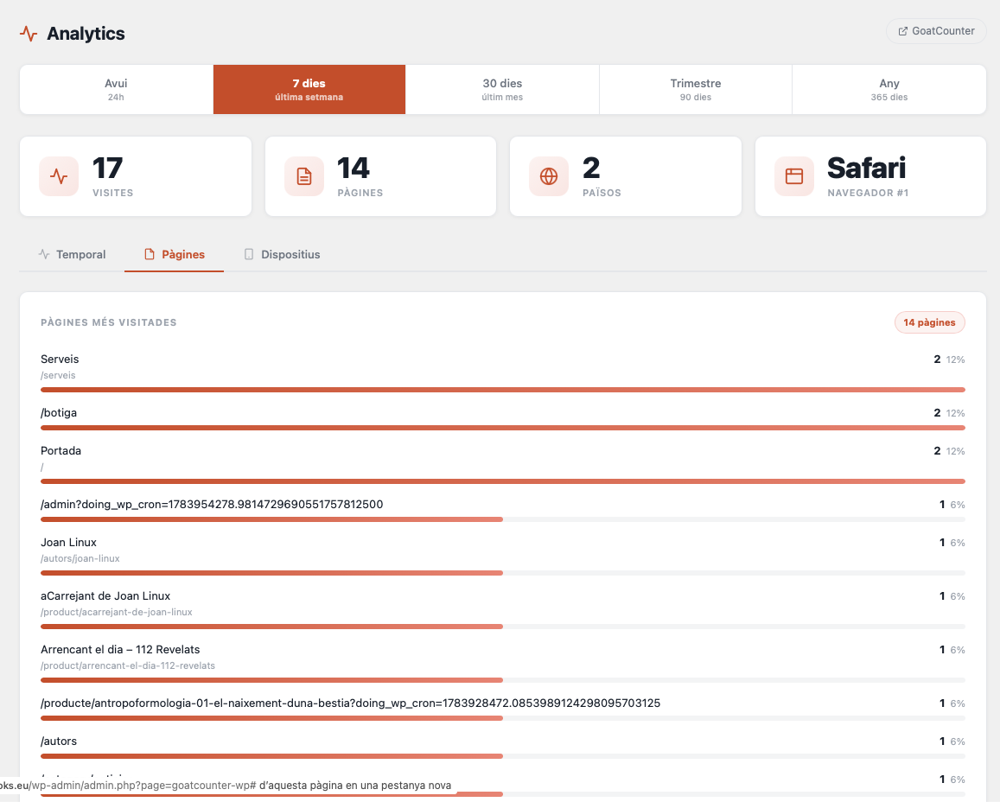
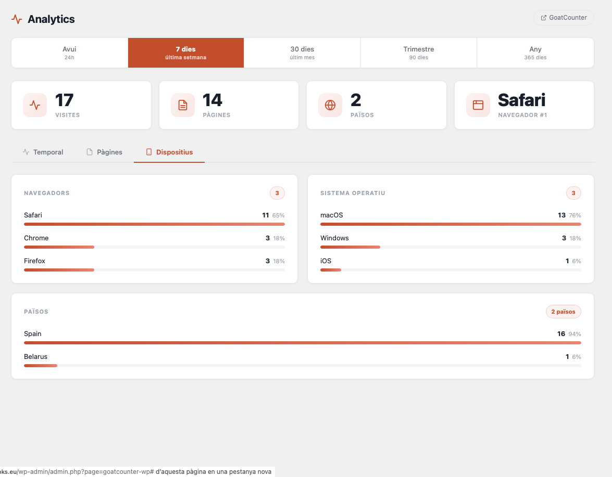
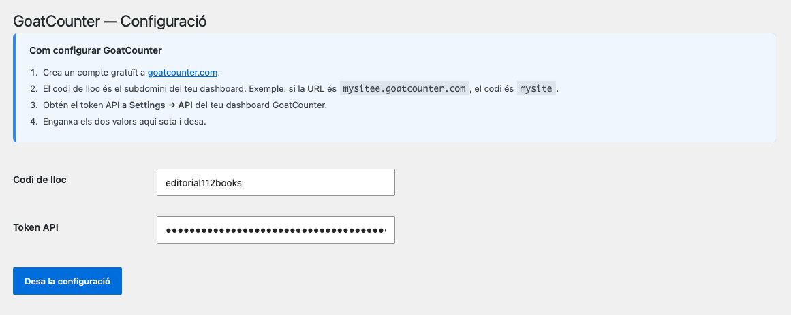

# GoatCounter Analytics for WordPress

Privacy-friendly analytics via [GoatCounter](https://www.goatcounter.com). No cookies, no GDPR banner needed. Full stats dashboard in your WordPress admin.

---

*[Llegeix-ho en català](#goatcounter-analytics-per-a-wordpress)*

---

## Features

- **No cookies** — no GDPR/cookie consent banner required
- **Lightweight** — single async script, zero performance impact
- **Dashboard with three tabs**: Temporal, Pages, Devices
- **Five time periods**: today, 7 days, 30 days, quarter (90 days), year (365 days)
- **SVG bar chart** with gradient, grid lines and adaptive granularity (hour/day/week/month)
- **Day-of-week distribution** with percentage and visit count
- **Top pages** with WordPress page title lookup and direct links
- **Browsers, OS and countries** with percentage bars
- **Summary metric cards** (total visits, pages, countries, top browser)
- **Active tab persisted** via localStorage across page reloads
- Available in **English and Catalan**

## Screenshots

## Requirements

- WordPress 6.0+
- PHP 7.4+
- A free [GoatCounter](https://www.goatcounter.com) account

## Installation

1. Download the plugin ZIP from the [releases page](https://github.com/112books/goatcounter-wp/releases) or via **Code → Download ZIP**
   - **macOS note:** Safari automatically unzips downloaded files and deletes the ZIP. To keep the ZIP, use **Right-click → Download Linked File**, or use Chrome/Firefox. WordPress requires the `.zip` file to install plugins.
2. In your WordPress admin: **Plugins → Add New → Upload Plugin**
3. Select the `.zip` file and click **Install Now**, then **Activate**
4. Go to **Analytics → Settings** and enter your GoatCounter site code and API token

## Setup

1. Create a free account at [goatcounter.com](https://www.goatcounter.com)
   - **Important:** GoatCounter sends a confirmation email when you register. You must click the link to activate your account before the API will work. Check your spam folder if you don't see it.
2. Go to **Analytics → Settings** in your WordPress admin
3. Enter your **site code** (the subdomain of your GoatCounter URL — e.g. `mysite` if your dashboard is at `mysite.goatcounter.com`)
4. Create your **API token**: GoatCounter dashboard → Settings → API tokens → Create token
   - **Important:** The API token section only appears after you have confirmed your email address. If you don't see it, check your inbox (and spam) for the GoatCounter confirmation email.
5. Paste the token into **Analytics → Settings** and save

The tracking script is injected automatically in the footer of every page.

## Privacy

GoatCounter does not use cookies, does not track personal data, and does not require a GDPR consent banner. All analytics data is stored on GoatCounter's servers (or your own if self-hosted).

## Changelog

### 1.2.0
- Redesigned dashboard with three tabs: Temporal, Pages, Devices
- New periods: quarter (90 days) and year (365 days)
- SVG bar chart with gradient, grid lines and adaptive granularity (hour/day/week/month)
- Day-of-week distribution with percentage and visit count
- Top pages with WordPress page title lookup and clickable links
- Browsers, OS and countries with percentage bars
- Period selector redesigned as a full-width segmented nav
- Summary metric cards with icons
- Active tab persisted via localStorage across page reloads
- Catalan day names (Dl–Dg) in weekly chart

### 1.1.0
- Stats dashboard with top pages, referrers and countries
- Period filter: today / 7 days / 30 days
- Catalan translation

### 1.0.0
- Initial release — tracking script injection and settings page

## License

GPL-2.0-or-later — see [LICENSE](https://www.gnu.org/licenses/gpl-2.0.html)

## Author

Built by [LinuxBCN](https://linuxbcn.com) for [112books.eu](https://112books.eu).

---

# GoatCounter Analytics per a WordPress

Analítica respectuosa amb la privacitat mitjançant [GoatCounter](https://www.goatcounter.com). Sense cookies, sense banner de consentiment. Panell complet d'estadístiques directament al tauler d'administració de WordPress.

---

*[Read in English](#goatcounter-analytics-for-wordpress)*

---

## Característiques

- **Sense cookies** — no cal cap banner de consentiment GDPR
- **Lleuger** — un sol script asíncron, zero impacte en el rendiment
- **Panell amb tres pestanyes**: Temporal, Pàgines, Dispositius
- **Cinc períodes**: avui, 7 dies, 30 dies, trimestre (90 dies), any (365 dies)
- **Gràfic de barres SVG** amb degradat, línies de guia i granularitat adaptativa (hora/dia/setmana/mes)
- **Distribució per dia de la setmana** amb percentatge i nombre de visites
- **Pàgines més visitades** amb títol de la pàgina WordPress i accés directe
- **Navegadors, SO i països** amb barres de percentatge
- **Targetes de resum** (visites totals, pàgines, països, navegador principal)
- **Pestanya activa recordada** via localStorage entre recàrregues
- Disponible en **català i anglès**

## Requisits

- WordPress 6.0+
- PHP 7.4+
- Un compte gratuït a [GoatCounter](https://www.goatcounter.com)

## Instal·lació

1. Descarrega el ZIP del plugin des de la [pàgina de releases](https://github.com/112books/goatcounter-wp/releases) o via **Code → Download ZIP**
   - **Nota per a macOS:** Safari descomprimeix automàticament els fitxers descarregats i llença el ZIP a la paperera. Per conservar el ZIP, fes **clic dret → Descarregar fitxer enllaçat**, o utilitza Chrome o Firefox. WordPress necessita el fitxer `.zip` per instal·lar plugins.
2. Al tauler de WordPress: **Plugins → Afegir → Pujar plugin**
3. Selecciona el fitxer `.zip` i clica **Instal·la ara**, després **Activa**
4. Ves a **Analytics → Configuració** i introdueix el codi de lloc i el token API de GoatCounter

## Configuració

1. Crea un compte gratuït a [goatcounter.com](https://www.goatcounter.com)
   - **Important:** GoatCounter envia un correu de confirmació en registrar-te. Has de clicar l'enllaç per activar el compte abans que l'API funcioni. Revisa la carpeta de SPAM si no el trobes.
2. Ves a **Analytics → Configuració** al tauler de WordPress
3. Introdueix el **codi de lloc** (el subdomini de la teva URL de GoatCounter — p.ex. `mysite` si el dashboard és a `mysite.goatcounter.com`)
4. Crea el **token API**: dashboard de GoatCounter → Settings → API tokens → Create token
   - **Important:** La secció de tokens API només apareix un cop has confirmat el correu electrònic. Si no la veus, revisa la safata d'entrada (i el SPAM) per al correu de confirmació de GoatCounter.
5. Enganxa el token a **Analytics → Configuració** i desa

L'script de seguiment s'injecta automàticament al footer de totes les pàgines.

## Privacitat

GoatCounter no fa servir cookies, no recull dades personals i no requereix cap banner de consentiment GDPR. Totes les dades queden als servidors de GoatCounter (o als teus propis si el fas servir en mode autoallotjat).

## Llicència

GPL-2.0-or-later — vegeu [LICENSE](https://www.gnu.org/licenses/gpl-2.0.html)

## Autor

Desenvolupat per [LinuxBCN](https://linuxbcn.com) per a [112books.eu](https://112books.eu).
